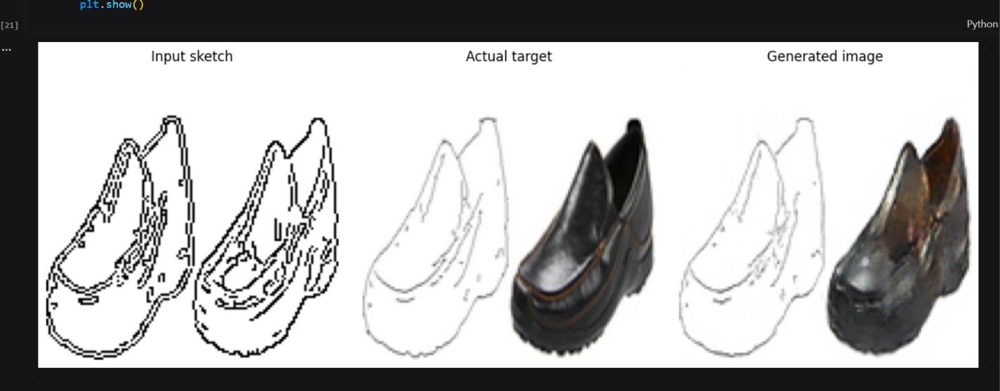

# Sketch-to-Image Generation using a Pix2Pix-Style Conditional GAN

A TensorFlow/Keras notebook that learns to translate edge-based shoe
sketches into shoe images using a Pix2Pix-style Conditional Generative
Adversarial Network (cGAN).

> **Project scope:** This implementation is trained on the Edges2Shoes
> dataset. It is intended for shoe sketch-to-image translation, not
> arbitrary sketch-to-anything generation.

## Overview

The notebook builds a paired image-to-image translation pipeline:

1.  Load shoe photographs from the Edges2Shoes dataset.
2.  Resize each image to `128 × 128`.
3.  Use OpenCV Canny edge detection to produce a sketch-like outline.
4.  Pair each generated sketch with its original shoe photograph.
5.  Train a U-Net Generator and a PatchGAN-style Discriminator.
6.  Visualize generated images and use an `ipywidgets` upload interface
    to test a sketch.

The notebook is designed to run in a Kaggle Notebook environment with
the dataset attached.

## Model architecture

### Generator --- U-Net

The Generator takes a three-channel `128 × 128` sketch and predicts a
three-channel image. Its encoder progressively downsamples the input,
while its decoder upsamples learned features. Skip connections
concatenate encoder features with corresponding decoder features to help
retain spatial details.

### Discriminator --- PatchGAN-style

The Discriminator receives both the input sketch and either the real
target image or the Generator's output. It concatenates the pair and
predicts real/fake scores over spatial patches rather than making only
one whole-image prediction.

### Training objective

The Generator is trained with an adversarial loss plus an L1
reconstruction loss:

`Generator loss = adversarial loss + λ × L1 loss`

The notebook uses `λ = 100`. The Discriminator learns to distinguish
real sketch--photo pairs from generated sketch--photo pairs. Both
networks use Adam optimizers with a learning rate of `2e-4` and
`beta_1 = 0.5`.

## Dataset and preprocessing

This notebook expects the Edges2Shoes dataset to be available at the
following Kaggle path:

``` text
/kaggle/input/datasets/balraj98/edges2shoes-dataset
```

The notebook: - Searches the dataset directory for `.jpg`, `.jpeg`, and
`.png` files. - Selects up to `5,000` images. - Resizes images to
`128 × 128`. - Converts images to grayscale and applies Canny edge
detection with thresholds `80` and `160`. - Inverts the edge map to
create dark outlines on a light background. - Concatenates the sketch
and original photo horizontally to store paired examples. - Uses a 90/10
training/validation split.

**Important limitation:** the sketches are generated automatically from
photographs using edge detection. They are not manually drawn sketches.
The quality and style of a real freehand sketch may differ from these
training inputs.

## Tech stack

-   Python
-   TensorFlow / Keras
-   OpenCV
-   NumPy
-   Matplotlib
-   Pillow
-   tqdm
-   Jupyter Notebook / Kaggle Notebooks
-   ipywidgets

## Getting started

### 1. Open the notebook in Kaggle

Upload `sketch-image (4)(1).ipynb` to Kaggle Notebooks, or import it
into a new Kaggle notebook.

### 2. Attach the dataset

Attach the Edges2Shoes dataset to the notebook and verify that the
dataset directory matches:

``` python
SOURCE_DIR = "/kaggle/input/datasets/balraj98/edges2shoes-dataset"
```

If Kaggle mounts the dataset at a different path, update `SOURCE_DIR`.

### 3. Check GPU availability

Run the first cell. It prints the TensorFlow version and detected GPU
devices. In Kaggle, select an available GPU accelerator from the
notebook settings if your account's quota and availability permit it.

### 4. Run the notebook cells in order

The notebook defines these main settings:

``` python
IMG_SIZE = 128
BATCH_SIZE = 1
EPOCHS = 30
MAX_IMAGES = 5000
```

Then it creates paired images, prepares the TensorFlow datasets, defines
the Generator and Discriminator, and trains the model. Training duration
depends on the accelerator and number of images selected.

### 5. Inspect generated results

The validation visualization displays: - Input sketch - Actual target
photograph - Generated image

Review these results to assess how well the model has learned the
mapping. Output quality depends on dataset size, training time, and the
input sketch's similarity to the training distribution.



### 6. Try the interactive upload interface

The final notebook cell creates an `ipywidgets` interface where you can
upload a `.png`, `.jpg`, or `.jpeg` image and click **Generate Shoe**.
It resizes the image to `128 × 128`, normalizes its pixels to `[-1, 1]`,
passes it to the trained Generator, and displays the result.

For best results, provide a clear, high-contrast shoe outline similar to
the edge maps used during training. The interface runs inside a
compatible Jupyter/Kaggle notebook; it is not a standalone web
application.

## Saving the model

The notebook saves the trained Generator to:

``` text
/kaggle/working/pix2pix_generator.keras
```

This is a Kaggle working-directory path. Download the model artifact
from the notebook output if you want to keep it outside the Kaggle
session. The notebook does not automatically include the trained model
file in this repository.


## Current limitations

-   Trained for shoe image translation using Edges2Shoes, not
    general-purpose image generation.
-   Training sketches are generated with Canny edge detection, not
    collected as freehand sketches paired with target images.
-   The notebook uses a fixed resolution of `128 × 128`.
-   The upload interface is an interactive notebook widget, not a
    deployed web app.
-   Generated quality has to be evaluated from actual outputs; the
    architecture alone does not guarantee realistic images.
-   The notebook's default dataset path is Kaggle-specific.

## Future improvements

-   Add a curated set of real hand-drawn shoe sketches paired with
    photographs.
-   Compare generated outputs across epochs and tune hyperparameters.
-   Track and plot Generator and Discriminator losses.
-   Save checkpoints and add a way to resume training.
-   Evaluate image quality using suitable visual and quantitative
    metrics.
-   Build a separate web interface for sketch upload and inference.
-   Experiment with higher-resolution images and data augmentation.

## Reproducibility notes

-   The notebook sets Python, NumPy, and TensorFlow random seeds to
    `42`.
-   Dataset selection is capped at `5,000` images.
-   The model is trained for `30` epochs by default.
-   GPU availability, TensorFlow/CUDA compatibility, and dataset mount
    paths may vary by environment.

## Acknowledgements

-   TensorFlow and Keras for model development.
-   OpenCV for Canny edge detection.
-   The Edges2Shoes dataset used by the notebook.
-   The Pix2Pix approach to paired image-to-image translation, which
    inspired this implementation.

------------------------------------------------------------------------

Built as a hands-on learning project to explore conditional GANs and
image-to-image translation.
